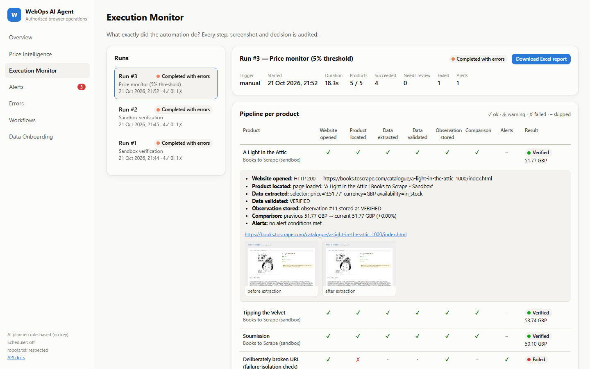
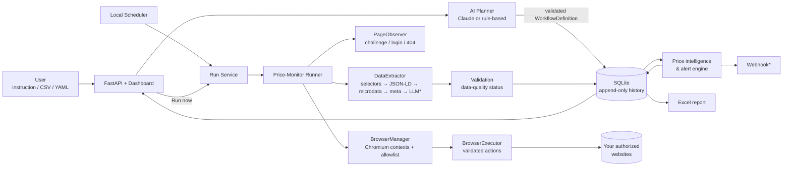
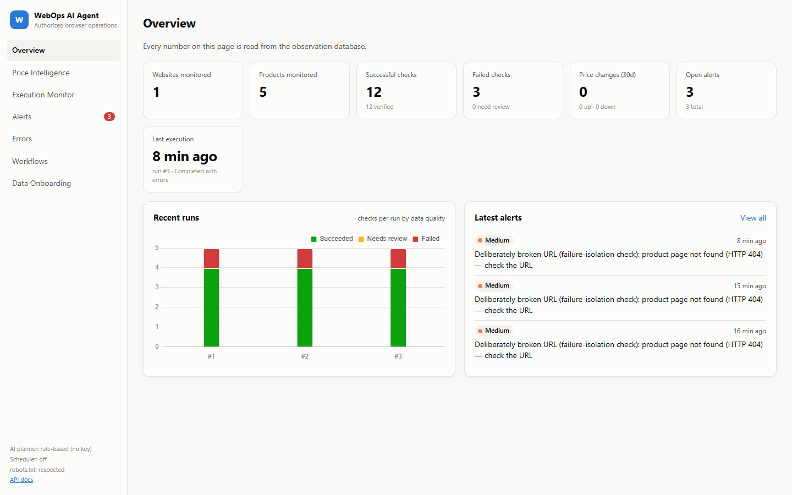
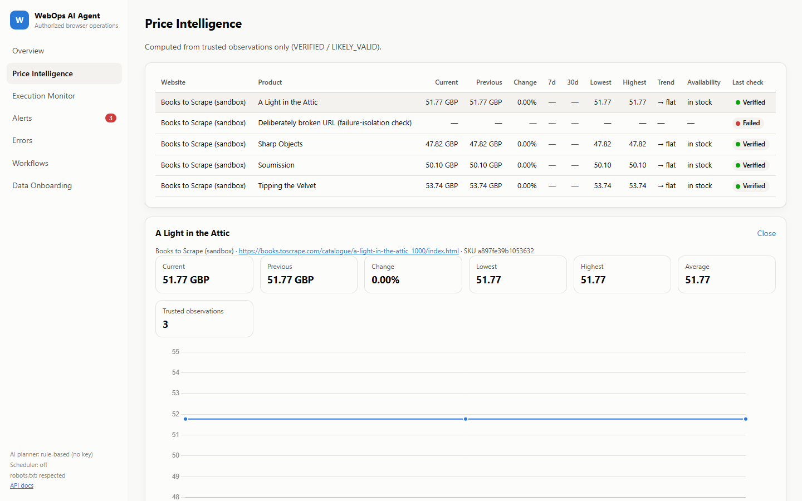
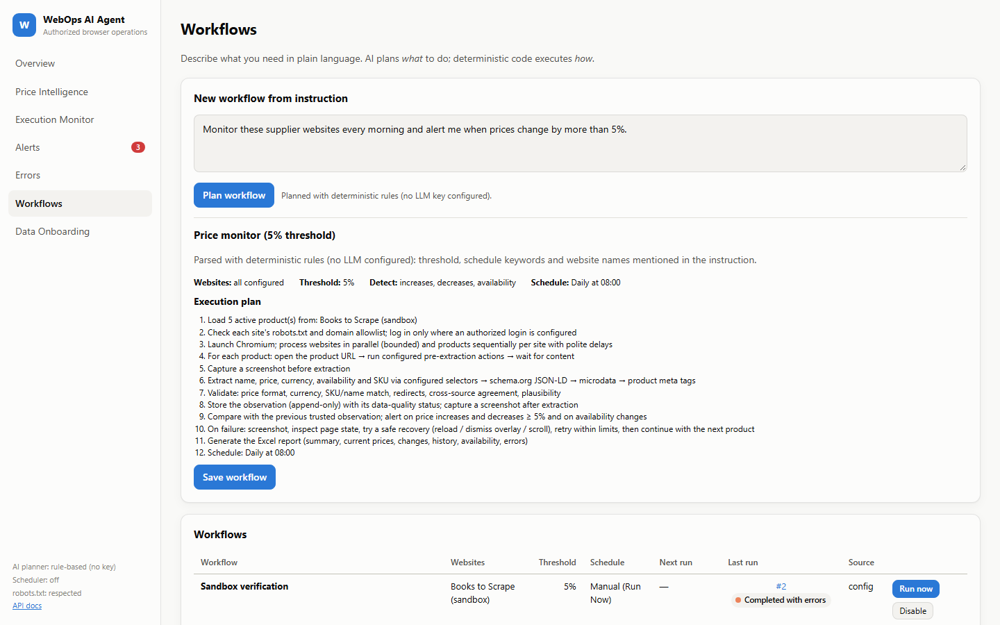

# WebOps AI Agent

**Natural language → AI planning → real browser → real data → business intelligence.**

WebOps AI Agent turns a plain-language business request such as
*"Monitor these supplier websites every morning and alert me when prices change by more than 5%"*
into a controlled, auditable browser-automation workflow. A real Chromium browser visits the
websites you configure, extracts prices and availability, validates every value, stores an
append-only price history, detects changes, raises alerts and produces an Excel report.

> This system is designed to automate **authorized** browser-based business workflows using
> **real-world data**. It ships with no supplier data, no mock portal and no demo mode: every
> metric in the dashboard and every row in a report comes from a real browser execution
> recorded in the database.



---

## Contents

[Business problem](#business-problem) · [Solution](#solution) · [Architecture](#architecture) ·
[Features](#features) · [Tech stack](#technology-stack) · [Installation](#installation) ·
[Configuration](#configuration) · [Adding websites](#adding-real-websites) · [Adding products](#adding-real-products) ·
[Running](#running-the-agent) · [Scheduling](#scheduling) · [Reports](#reports) · [Security](#security) ·
[Data quality](#data-quality) · [Error handling](#error-handling) · [Screenshots](#screenshots) · [API](#api) ·
[Testing](#testing) · [Limitations](#limitations) · [Roadmap](#roadmap)

## Business problem

Procurement and pricing teams check supplier and competitor websites by hand: open dozens of
product pages, copy prices into a spreadsheet, compare against last week, and hope nothing was
missed. It is slow, error-prone, and leaves no trustworthy history. Generic scrapers break silently
when a page changes and happily store wrong numbers.

## Solution

- **AI decides *what*** — Claude (optional) turns an instruction into a validated workflow definition:
  which configured websites, which threshold, which changes matter, which schedule.
- **Deterministic code decides *how*** — Playwright executes validated, structured browser actions.
  The LLM never drives the browser freely and can never add a domain.
- **Trust is earned, not assumed** — every observation gets a data-quality status
  (`VERIFIED / LIKELY_VALID / NEEDS_REVIEW / FAILED`); only trusted values feed comparisons and alerts.
- **Everything is auditable** — each run records every step, decision and screenshot, so you can answer
  *"what exactly did the automation do?"*

### Real-world use case (first production workflow)

Supplier / product price monitoring: for each configured product the agent records supplier,
product name, SKU, URL, price, currency, availability, timestamp and metadata; compares with the
previous trusted observation; and flags increases, decreases, products becoming unavailable or
available again, extraction failures, website failures and suspicious changes.

## Architecture



\* optional

| Layer | Module | Responsibility |
|---|---|---|
| Config | `app/config` | Settings from env; schema for `websites.yaml` / `workflows.yaml` |
| Security | `app/security` | Domain allowlist, robots.txt, credential resolution, secret masking |
| Browser | `app/browser` | `BrowserManager`, `BrowserExecutor`, `PageObserver`, `DataExtractor`, site inspector |
| Agent | `app/agent` | `LLMProvider` / `ClaudeProvider`, workflow planner, recovery suggestions |
| Workflows | `app/workflows` | Runner (retries, recovery, isolation), audit recorder, run service |
| Services | `app/services` | Price parsing, structured data, validation, intelligence, alerts, import, config sync |
| Reporting | `app/reporting` | Six-sheet Excel report |
| Scheduler | `app/scheduler` | DB-persisted schedules, swappable trigger |
| API / UI | `app/api`, `frontend/` | REST API, static dashboard |

## Features

- Natural-language workflow creation with a reviewable execution plan (works without an API key via deterministic rules)
- Real Chromium automation: navigation, clicking, form filling, select, scroll, wait, extract, screenshots, downloads, multiple tabs, saved login sessions, headless or headed
- Multi-strategy extraction with cross-source corroboration and an evidence-checked LLM fallback (the price must appear verbatim on the page)
- Validation of price format, currency, SKU, product name, redirects, plausibility, HTTP status and page-structure changes
- Price intelligence: current, previous, absolute and % change, 7-/30-day change, low/high/average, trend, availability changes
- Alerts with severity, reason, previous/current value, % change and status (open → acknowledged → resolved); optional webhook
- Six-sheet Excel report generated after each run (and on demand)
- Execution monitor: per-product pipeline checklist, step messages, validation issues and screenshots
- CSV / Excel / YAML / JSON product import with row-level validation summary
- Local scheduler (interval / daily / weekly) that survives restarts
- Site inspector to discover selectors on a real page before configuring it

## Technology stack

Python 3.11+ · FastAPI · SQLModel/SQLAlchemy (SQLite, WAL) · Pydantic v2 · Playwright (Chromium) ·
openpyxl · Anthropic Python SDK (Claude) · vanilla JS + Chart.js · pytest · ruff · Docker

## Installation

**Windows (PowerShell)**

```powershell
git clone https://github.com/ah0890/webops-ai-agent.git
cd webops-ai-agent
.\scripts\setup.ps1          # venv, dependencies, Chromium, config copies, tests
```

**macOS / Linux**

```bash
git clone https://github.com/ah0890/webops-ai-agent.git
cd webops-ai-agent
bash scripts/setup.sh
```

**Manual**

```bash
python -m venv .venv && source .venv/bin/activate     # Windows: .venv\Scripts\activate
pip install -r requirements.txt
python -m playwright install chromium
cp .env.example .env
```

**Docker**

```bash
cp .env.example .env            # and create config/websites.yaml (see below)
docker compose up --build       # http://127.0.0.1:8000
```

## Configuration

All runtime settings come from environment variables / `.env` (see [.env.example](.env.example)):
threshold, plausibility limit, currencies, browser mode and timeouts, concurrency, per-site delays,
retries, run timeout, robots.txt policy, optional `ANTHROPIC_API_KEY`, optional `API_KEY` for the
REST API, optional alert webhook. Your real supplier data lives in git-ignored files:

| File | Purpose |
|---|---|
| `config/websites.yaml` | Websites, allowed domains, selectors, login steps, availability wording, products |
| `config/workflows.yaml` | Named workflows with thresholds and schedules |
| any CSV/XLSX/YAML/JSON | Bulk product import |

Configuration changes never require code changes. Load them with `python -m app.cli sync`
(also done automatically when the server starts) or **Sync configuration** in the dashboard.

## Adding real websites

1. Inspect a real product page — never guess selectors:

   ```bash
   python -m app.cli inspect "https://<supplier-domain>/<product-page>"
   ```

   The report lists schema.org JSON-LD / microdata / meta price data, price-like elements with a
   suggested CSS selector, availability wording, login/challenge signals and a screenshot.
2. Copy [config/websites.example.yaml](config/websites.example.yaml) to `config/websites.yaml` and fill in:
   `name`, `base_url`, `allowed_domains`, `currency`, optional `selectors`, `request_delay_seconds`.
3. If the portal needs an **authorized** login, either configure `login.steps` with
   `${ENV_VAR}` credentials from `.env`, or log in yourself once (handles 2FA) and save the session:

   ```bash
   python -m app.cli login-session "<SUPPLIER NAME>"
   ```

## Adding real products

- In YAML, under each website's `products:` (`name`, `url`, optional `sku`, `price_change_threshold`, `expected_name_contains`).
- Or import a list — columns: `supplier, product_name, sku, product_url, currency, price_change_threshold, active`
  ([template](config/products.example.csv)):

  ```bash
  python -m app.cli import products.csv --dry-run   # validate only
  python -m app.cli import products.csv
  ```

  The summary accounts for every row (`total / valid / imported / updated / duplicates / invalid`) with
  row-level reasons: bad URLs, duplicates (normalised), missing names or suppliers, invalid thresholds,
  unsupported currencies, and URLs outside an existing supplier's allowed domains.

## Running the agent

```bash
python -m app.cli serve                      # dashboard + API + scheduler → http://127.0.0.1:8000
python -m app.cli plan "Monitor my suppliers every morning, alert on 5% price changes" --save
python -m app.cli workflows                  # list workflows
python -m app.cli run "<workflow name or id>" [--headed]
python -m app.cli report <run_id>            # regenerate the Excel report
```

Watch a run live in **Execution Monitor**; use `--headed` (or `BROWSER_HEADLESS=false`) to see the browser.

## Scheduling

Schedules are `manual`, `interval` (`every_hours`), `daily` (`at: "HH:MM"`, host local time) or
`weekly` (`weekday` + `at`). The local scheduler runs inside the server, stores `next_run_at` in the
database (so schedules survive restarts) and never starts a second run of a workflow that is still
running. Execution goes through a single `trigger(workflow_id)` callable, so it can be replaced by
APScheduler, Celery beat or a cloud scheduler without touching the runner.

## Reports

Generated automatically after each run (`reports/`) and downloadable from the dashboard or
`GET /api/runs/{id}/export`:

| Sheet | Content |
|---|---|
| Executive Summary | Run facts, data-quality counts, increases/decreases, alerts, top movers, optional AI summary written from those figures only |
| Current Prices | Every product checked in the run with price, quality status, previous price, change, 7d/30d, low/high/avg, trend |
| Price Changes | Changes vs the previous trusted observation, threshold and whether it alerted |
| Historical Observations | Full observation history for the run's products |
| Availability Changes | Stock transitions |
| Errors - Failed Checks | FAILED / NEEDS_REVIEW observations with reasons and screenshot paths, plus failed steps |

## Security

- **Domain allowlist** — every navigation (including redirects and new tabs) is checked against the website's `allowed_domains`; off-list navigations are blocked at the network layer. Private/loopback IPs are refused unless explicitly listed.
- **Structured actions only** — every browser action is a validated Pydantic model; unknown actions/fields are rejected. LLM recovery suggestions are restricted to click/scroll/wait/press.
- **No access-control bypass** — CAPTCHAs, bot challenges, paywalls and login walls are *detected and reported*, never solved or circumvented. The browser uses Chromium's real user agent plus an identifying suffix.
- **Credentials** — only from environment variables (`${NAME}` references); YAML validation rejects literal secrets; values are masked in logs, audit steps and errors. Saved sessions, `.env` and your config are git-ignored.
- **Politeness** — robots.txt respected by default (per-site override for authorized use), per-site delays, crawl-delay honoured, bounded concurrency, retry and run-time limits.
- **API** — optional `X-API-Key` for all mutating endpoints; screenshot serving is path-traversal safe; Docker binds to localhost and runs as a non-root user.
- **Dashboard** — all scraped text is rendered with `textContent`, never parsed as HTML.

## Data quality

| Status | Meaning | Used for comparisons? |
|---|---|---|
| `VERIFIED` | Clean, and corroborated (configured selector or ≥ 2 independent sources agree) | Yes |
| `LIKELY_VALID` | Clean single source, or minor warnings (currency assumed from config, selector missing but structured data found, LLM extraction) | Yes |
| `NEEDS_REVIEW` | Ambiguous price, currency mismatch/change, sources disagree, redirect, wrong product/SKU, implausible change (> `MAX_PLAUSIBLE_CHANGE_PCT`) | No — stored and flagged |
| `FAILED` | No/negative price, HTTP error, not found, blocked, login required | No — stored and flagged |

Every issue is stored with the observation, so a reviewer sees exactly why.

## Error handling

Real websites change, so the runner is built for failure. When a product fails it:

1. captures a screenshot, 2. records the error, 3. inspects page state (challenge, login wall,
404, overlays), 4. applies a safe recovery strategy (reload & wait → dismiss overlays & scroll →
wait longer, or a validated Claude suggestion), 5. retries within `MAX_RETRIES`, 6. stores a FAILED
observation with reasons, and 7. **continues with the next product**. Non-retryable states
(blocked, login required, 404, outside allowlist) fail fast. A site where every product fails
raises a `website_failure` alert; one broken website never stops the run.

## Screenshots

Screenshots are stored under `screenshots/run_<id>/<website>/` and linked to run, website and
product: before extraction, after successful extraction, and on errors. They are viewable from the
Execution Monitor and Errors pages.

The images in this README come from real runs against
[books.toscrape.com](https://books.toscrape.com), a public website published for scraping practice,
used here to verify the pipeline end-to-end (`scripts/verify_sandbox.sh`). The broken URL in those
runs is deliberate, to demonstrate failure isolation.

| Overview | Price intelligence |
|---|---|
|  |  |
| **Workflow planning** | **Execution monitor** |
|  |  |

## API

Interactive OpenAPI documentation is served at **`/docs`** (Swagger) and **`/redoc`**.

| Method | Path | Description |
|---|---|---|
| POST | `/api/workflows` | Create from `{"instruction": ...}` (AI planner) or `{"definition": ...}` |
| POST | `/api/workflows/plan` | Preview a plan without saving |
| GET | `/api/workflows` · `/api/workflows/{id}` | List / detail with recent runs |
| PATCH | `/api/workflows/{id}` | Enable/disable, schedule, threshold |
| POST | `/api/workflows/{id}/run` | Run now (202; 409 if already running) |
| GET | `/api/runs` · `/api/runs/{id}` | Runs / run detail |
| GET | `/api/runs/{id}/steps` · `/products` · `/logs` | Audit trail, per-product pipeline, log |
| GET | `/api/runs/{id}/alerts` · `/observations` · `/screenshots` | Run artefacts |
| GET | `/api/runs/{id}/report` · `/export` | Report JSON · Excel download |
| GET | `/api/products` · `/api/products/{id}/history` | Products with intelligence · history series |
| GET | `/api/websites` | Websites and configuration status |
| GET | `/api/dashboard/overview` · `/api/alerts` · `/api/errors` | Dashboard data |
| PATCH | `/api/alerts/{id}` | Acknowledge / resolve |
| GET | `/api/screenshots/{id}` | Screenshot image |
| POST | `/api/import/products` · `/api/config/sync` | Onboarding |

## Testing

```bash
pytest                                            # automated suite: fixtures only, no network
WEBOPS_RUN_INTEGRATION=1 pytest tests/integration # opt-in: real end-to-end run against the public sandbox
ruff check app tests
```

The automated suite covers price parsing, structured-data extraction, every validation rule,
intelligence and alert logic, action validation, allowlist and secret masking, import accounting,
planner guardrails, scheduling, the API (metrics derived from the DB, export, auth, path traversal)
and the browser layer on local HTML in real Chromium. Integration tests against your own websites
belong in `tests/integration/` and stay opt-in so the suite never depends on external sites.

## Limitations

- **Website structure** — heavily client-rendered pages without structured data need a configured selector; selectors must be updated when a site redesigns (the run flags `selector_missing` / `no_data` when that happens).
- **Authentication** — CAPTCHAs, bot challenges and 2FA are never bypassed; such sites need a manually saved session (`login-session`) and may still block automation. Sessions expire.
- **Rate limits** — politeness delays and bounded concurrency trade speed for good citizenship; 1,000+ products on one site takes time by design.
- **Variants & personalised pricing** — prices that depend on size/colour selection, location, login tier or cart contents need product-specific actions (`select`/`click`) and may differ from what a buyer sees.
- **Currency & tax** — the agent records the price as displayed; it does not convert currencies or normalise tax/shipping.
- **SQLite** — fine for a single node and tens of thousands of observations per day; move to PostgreSQL for multi-node deployments.
- **Docker** — the image is provided but was not built in the development environment for this release.

## Roadmap

1. Change-aware selector self-healing: when a configured selector disappears, propose a new one from the structured-data match and the inspector, for one-click approval.
2. PostgreSQL + task queue (Celery/RQ) for multi-worker scale; per-domain rate limiter service.
3. Notification channels (email, Slack, Teams) with digest rules.
4. Variant-aware products (option selection actions) and shipping/tax capture.
5. Additional workflow types (stock-level monitoring, document downloads from supplier portals).

## License

MIT
